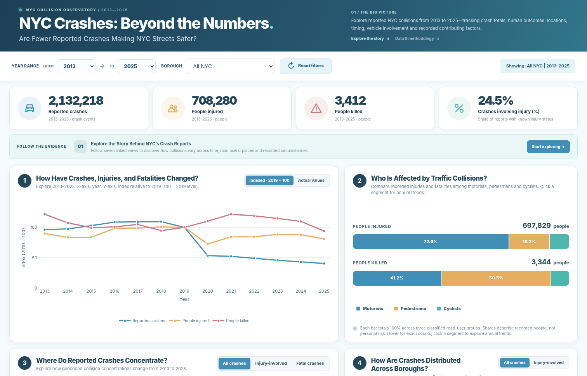

# NYC Crashes: Beyond the Numbers

> **Website-only edition.** This version omits the large cleaned Parquet file so the code can be uploaded using GitHub's website. The dashboard still works in full using its bundled, preaggregated data. For the Parquet file and optional inspection script, use the full repository ZIP.


**An interactive exploration of New York City motor-vehicle collision reports (2013–2025)**

> **Research question:** Are fewer reported crashes making NYC streets safer?

A narrative-led, interactive website exploring not just the number of reported collisions, but also how injuries, fatalities, locations, timing, vehicle combinations and recorded contributing factors vary. Seven linked views help readers move from the overall trend to the human impact and the circumstances recorded in crash reports.



## Explore the dashboard

The project is a **static website** suitable for GitHub Pages. It uses HTML, CSS and JavaScript with a locally bundled Plotly library and browser-ready aggregated data. It does **not** need an API key, backend, database connection or Python server in production.

**Features**

- Interactive year-range and borough filters, with reset controls and contextual KPIs.
- A seven-step guided story, or independent exploration of every chart.
- Indexed-versus-actual annual trends, plus road-user category drilldown charts.
- A looping, pausable geographic animation of aggregated geocoded reports.
- An interactive borough-share donut, weekday–hour bubble matrix and vehicle-combination heatmap.
- Ranked recorded factors with selectable metric and top-N display; missing/Unspecified categories are explained.
- Tooltips for exact values and metadata; notes explaining interpretation limits.

## Seven views

| # | Question explored | Visualization |
| --- | --- | --- |
| 1 | How have crashes, injuries and fatalities changed? | Indexed / actual-value line chart |
| 2 | Who is affected by traffic collisions? | 100% stacked bars + annual drilldown |
| 3 | Where do reported crashes concentrate? | Animated geographic density marks |
| 4 | How are crashes distributed across boroughs? | Interactive donut chart |
| 5 | When do reported crashes occur? | Day × hour bubble matrix |
| 6 | Which vehicle types appear together in crashes? | Upper-triangular heatmap |
| 7 | Which contributing factors are most often recorded? | Interactive factor ranking |

## Project structure

```text
nyc-crashes-beyond-the-numbers/
├── index.html                  # GitHub Pages entry point
├── assets/
│   ├── css/dashboard.css       # Styles, layout and responsive design
│   ├── js/dashboard.js         # Charts, filters, tooltips and guided story
│   ├── js/dashboard-data.js    # Embedded preaggregated data (browser-ready)
│   ├── js/plotly.bundle.js     # Plotly library bundled locally
│   └── images/dashboard-preview.png
├── data/README.md            # Explains why Parquet is omitted here
├── docs/
│   ├── DATA_DICTIONARY.md
│   ├── METHODOLOGY.md
│   └── THIRD_PARTY_NOTICES.md
├── .gitignore
├── .gitattributes
└── .nojekyll
```

`index.html` loads local CSS/JS assets using **relative paths**, which allows the site to work under a GitHub Pages project URL. Keep the folder structure intact.

## Quick start

1. Download and extract the repository ZIP.
2. Open `index.html` in a modern desktop browser, or start a local static server from the project directory:

   ```bash
   python -m http.server 8000
   ```

3. Open **http://localhost:8000** to explore the dashboard. Chrome or another up-to-date Chromium browser is recommended.

> The Parquet dataset is **not fetched by the dashboard**. The site uses `assets/js/dashboard-data.js`. Users can browse the site immediately, even without installing Python packages.

## Deploy to GitHub Pages (browser upload)

1. Create a GitHub repository named `nyc-crashes-beyond-the-numbers` (or any name you prefer).
2. Extract this ZIP. In GitHub, choose **Add file → Upload files** and upload the **contents** of the extracted folder, not the ZIP file itself. Keep the `assets/`, `docs/`, and `data/` folders with `index.html` at the repository root.
3. Open **Settings → Pages**. Under *Build and deployment*, choose **Deploy from a branch**, select **main**, folder **/(root)**, and save.
4. The site will be published at a URL similar to `https://YOUR_USERNAME.github.io/nyc-crashes-beyond-the-numbers/`.

> This edition deliberately excludes the large Parquet file, which cannot be uploaded through GitHub's 25 MiB-per-file browser limit. The browser dashboard does not need it. To host the cleaned dataset in GitHub as well, use the **full repository ZIP** and Git/GitHub Desktop.

## Dataset and provenance

- **Original public source:** [NYC Open Data — Motor Vehicle Collisions: Crashes](https://data.cityofnewyork.us/Public-Safety/Motor-Vehicle-Collisions-Crashes/h9gi-nx95).
- **Dashboard period:** 2013–2025.
- **Browser data:** `assets/js/dashboard-data.js` contains the preaggregated values used by the dashboard; no Parquet reader is required.
- **Cleaned data:** The separately provided full repository ZIP contains a 53 MiB Parquet file with 2,132,218 records and 35 columns. It is **not included** in this website-only edition.
- **Methodology:** See [Methodology](docs/METHODOLOGY.md) and the [Data dictionary](docs/DATA_DICTIONARY.md) for descriptions and limitations. The original ETL procedure was not provided and is not claimed to be reproduced here.

## How to interpret the results

- A **crash count** is a number of reported collision events; **people injured/killed** count individuals.
- **Injury-involved (%)** is the proportion of crashes with at least one reported injury among reports with a known injury status.
- The map shows only incidents with usable coordinates and aggregates them into spatial bins rather than exposing individual crash markers.
- Known-borough donut shares exclude unknown-borough records from the five-borough denominator while displaying them separately.
- Recorded contributing factors do not establish causation or fault; the sum of factor counts can exceed the number of crash reports.
- Travel activity and NYPD reporting practices changed in/around **April 2020**. **Reported counts are not exposure-adjusted crash risks.**

See [Methodology and limitations](docs/METHODOLOGY.md) for definitions and caveats.

## Technology and attribution

- HTML5 / CSS3 / JavaScript (static-site architecture)
- Plotly.js 3.3.1 (locally bundled)
- Browser Canvas / SVG for custom maps and matrices
- Parquet for cleaned tabular data
- Data: NYC Open Data, *Motor Vehicle Collisions — Crashes*

[Third-party notices](docs/THIRD_PARTY_NOTICES.md) lists attribution and third-party license references. This package does **not** assign a new project-level software license; determine the team's licensing preference before adding one.

---

**NYC Crashes: Beyond the Numbers** · Interactive data storytelling project · Data coverage: 2013–2025
